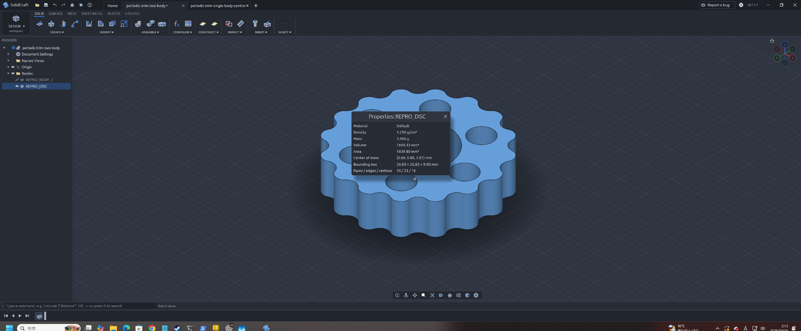
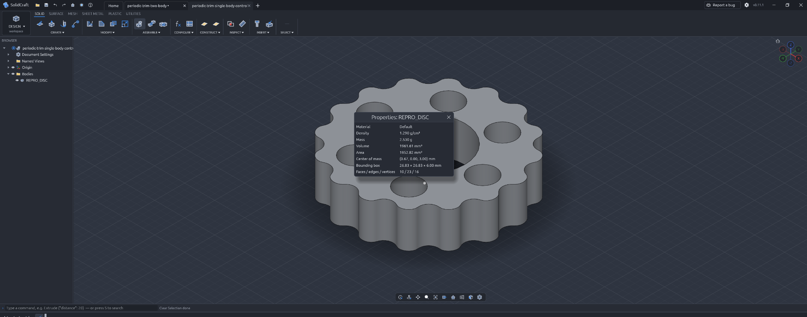

# Solidcraft issue #1452: periodic-trim reproduction

Reproduction data and actual application screenshots for [bherbruck/solidcraft#1452](https://github.com/bherbruck/solidcraft/issues/1452).

## Files

- [periodic-trim-two-body.step](periodic-trim-two-body.step): individual two-body STEP reproduction fixture.
- [periodic-trim-single-body-control.step](periodic-trim-single-body-control.step): individual single-body control STEP fixture.

These are ordinary repository files, available individually without extracting an archive. The original fixture-generation script was not available for this publication; no substitute generator is claimed or included.
- [Two-body GUI screenshot](periodic-trim-two-body-gui.png).
- [Single-body control GUI screenshot](periodic-trim-single-body-control-gui.png).

The screenshots were supplied by the reporter and show the actual Solidcraft GUI. They are not generated illustrations or CLI captures. The geometry owner authorized public sharing of these reproduction files.

## Reproduce

1. Download both STEP files from this repository.
2. In Solidcraft v0.11.1, open each STEP file separately.
3. Inspect the `REPRO_DISC` body and its Properties dialog in both imports.
4. Compare the displayed geometry, volume, and bounding-box dimensions.

Both supplied screenshots show properties for `REPRO_DISC`:

| Input | GUI volume (mm³) | GUI bounding-box dimensions (mm) |
|---|---:|---|
| Two-body STEP | 2640.33 | 26.83 × 26.83 × 9.00 |
| Single-body control | 1961.61 | 26.83 × 26.83 × 6.00 |

### Two-body import

### Single-body control

## Scope and caveats

The screenshots document an observed GUI difference, not a proven root cause. The issue contains the detailed mesh diagnostics and unsuccessful candidate changes. No general fix is claimed here.

Independent OCP/OCCT comparisons of the saved input shapes agree on volumes, bounds, and cut results. However, the common-volume comparison has a 0.07774158 mm³ discrepancy. These checks therefore do not establish unconditional geometric equivalence. OCP/OCCT was used for independent geometry measurements; its source was not read or copied into a patch.

This documentation was prepared with AI assistance. The supplied screenshots remain the reporter's original images. No software patch or new license is included.

## Integrity

| File | Bytes | SHA-256 |
|---|---:|---|
| periodic-trim-two-body-gui.png | 1214290 | `1e9177ffff0848127d105bc968906fc69b3946eeb9295dfb57a54713a7278fb4` |
| periodic-trim-single-body-control-gui.png | 1032815 | `fed8e3bbaaf58d5c3314aac991e21ce22cf76eac8177e5e48fd271f9fe4fe361` |
| periodic-trim-two-body.step | 421460 | `9d1705e6b2c57325751b5d8440737ee834371324495cc01d9825c9b6d7a00ba0` |
| periodic-trim-single-body-control.step | 416729 | `87659db3bef5867b84270ae57569d5654bbafaae3d84a12e89582e37a855102f` |
